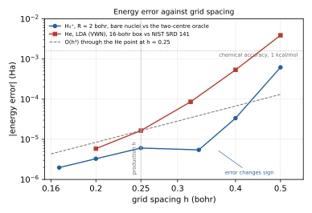

# cdft — a real-space Kohn–Sham solver with physics gates

[](https://github.com/VaclavSvo/Density-functional-theory-on-real-space-grids/actions/workflows/tests.yml)
[](LICENSE)

`cdft` is an all-electron, real-space density-functional-theory solver for the one- and
two-electron systems H, He⁺, He, H₂⁺ and H₂, written in PyTorch (float64, CPU and CUDA). It solves
the Kohn–Sham equations on a uniform finite-difference grid with the nuclear cusp factored out
analytically, so the grid never sees the Coulomb singularity, and it attaches a verdict from a
catalogue of physics gates to every number it produces. A result that fails a gate is stored as
invalid rather than quietly joining a dataset.

The scope today is exactly that: Z ≤ 2, at most two electrons, spin-restricted, at the
non-interacting, LDA and PBE levels. Those are the systems where the exact answer is either free
(one electron) or known to high accuracy, which is what makes them useful as reference data. The
longer-term purpose — a **non-neural reference instrument** for training and judging learned
exchange–correlation functionals and physics-informed networks, with the focus on self-interaction
error — is the next phase, described in [`docs/04_ROADMAP.md`](docs/04_ROADMAP.md); the training
corpus and the Kohn–Sham inversion it needs are not built yet. What is enforced already is the
boundary: there is no machine learning in `src/cdft/`, and gate G5.7 fails the build if any appears.

## Highlights

- **All-electron on a uniform grid.** The Kato factor `exp(−Σ Z_a |r − R_a|)` is removed from the wavefunction
  analytically; the transformed operator is discretised in a staggered divergence form and
  integrated with a cusp-aware quadrature. Hydrogenic energies are exact to 1e-13 Ha on a 33³ grid.
- **56 physics gates in seven tiers**, from algebraic identities (Hermiticity, orthonormality,
  convergence order) through exact limits (hydrogenic spectra, uniform scaling, the virial theorem,
  Lieb–Oxford), internal consistency (Harris–Foulkes, Janak), numerical convergence, literature
  reproduction, and process gates against silent failure. Thresholds are EXACT, DERIVED or
  EMPIRICAL, each with its source, and are never raised to pass.
- **Independent oracles.** A radial Kohn–Sham solver for atoms, a prolate-spheroidal solver for
  H₂⁺ at any bond length, NIST SRD 141 totals, PySCF/libxc for the functionals, and pinned golden
  values that fail the build when a number moves.
- **Derived grids, recorded provenance.** Grid spacing and box are derived from the structure, not
  configured; every override is written into the record together with the git commit, config
  hash, package versions, device and precision policy.
- **CPU float64 is the audit reference; CUDA reproduces it** to 5e-15 Ha on the energies.

## Accuracy at production settings

| system | functional | error (Ha) | reference | one solve |
|---|---|---|---|---|
| H, He⁺ | none (bare nucleus) | 1.9e-13, 7.8e-13 | exact −Z²/2 | 0.7 s (CPU) |
| H₂⁺ at R = 2 | none | 6.1e-6 | two-centre oracle | 11 s (GPU) |
| H | LDA (VWN) | 1.7e-6 | NIST SRD 141 | 33 s |
| He⁺ | LDA | 7.7e-6 | NIST SRD 141 | 12 s |
| He | LDA | 1.7e-5 (5.9e-6 at `--res fine`) | NIST SRD 141 | 16 s |
| He | PBE | 6.9e-5 | PySCF cc-pV5Z (±1.8e-4) | 15 s |
| H₂ at R = 1.4 | LDA / PBE | 6.7e-5 / 7.2e-5 | PySCF cc-pV5Z (±1.4e-4) | 65 s / 81 s |

GPU times are on a GTX 1660 Ti (6 GiB) in float64. The self-consistent path is interpolation-limited
to roughly O(h³); the default spacing h = 0.25 bohr is a cost choice, and `--res fine` (h = 0.20) or
`--res reference` (h = 0.16) buys the 1e-6 Ha regime where memory allows. The complete accuracy
ledger, the numerical standard and the open-items table are in [`docs/02_STATUS.md`](docs/02_STATUS.md).

<p align="center"></p>

*Energy error against grid spacing, measured on two CPU cores with the current tree. He at LDA on a
16-bohr box falls from 3.9e-3 Ha at h = 0.5 to 5.9e-6 Ha at h = 0.2 against NIST, steeper than h³
at coarse spacing and approaching the O(h³) of its density interpolant at fine spacing. Bare H₂⁺
against the two-centre oracle changes sign near h ≈ 0.35 and is 6.1e-6 Ha at the production
spacing, 2.0e-6 at h = 0.167. `python scripts/convergence_figure.py run` reproduces the data (about
15 minutes), `draw` the figure; the rungs are versioned in `docs/figures/convergence_ladders.json`.*

## Installation

Python 3.11 or newer.

```bash
git clone https://github.com/VaclavSvo/Density-functional-theory-on-real-space-grids.git
cd Density-functional-theory-on-real-space-grids
pip install -e ".[dev]"            # torch, numpy, scipy, h5py, pyyaml + pytest
pip install -e ".[dev,figures]"    # + matplotlib, for figures.py
pip install -e ".[dev,oracles]"    # + PySCF (Linux/WSL): live libxc and Gaussian-basis checks
```

On Windows, install the CUDA build of PyTorch that matches your driver first
(`pip install torch --index-url https://download.pytorch.org/whl/cu128`) and leave PySCF out: its
reference values are stored in `src/cdft/reference/computed.py`, and the gates that need it live
report SKIPPED with a reason. Keep one BLAS stack per environment — a conda MKL numpy next to a pip
torch aborts the interpreter on the first BLAS call after `import torch`. If that happens,
`python scripts/probes/blas_probe.py` names the offending call; the fix is in
[`docs/03_METHOD.md`](docs/03_METHOD.md) Part A §9.

## Quick start

```bash
python run.py --setups                        # every system, its resolution levels and grid sizes
python run.py h_atom he_plus h2plus_R2        # solve and print the gate tables; seconds each
python run.py he_atom_lda --device cuda       # self-consistent LDA at production resolution
python run.py he_atom_lda --res fine          # h = 0.20 instead of 0.25
python run.py h2_R1.4_pbe --corpus out.h5     # append the record to an HDF5 corpus
```

The exit code is the verdict: 0 when every gate passed or is a registered known-open failure, 1 for
a new failure or an unconverged run, 2 for a mistake in the command, found before anything is
solved. A run prints one row per gate:

```
gate     verdict        measured     threshold  name
------------------------------------------------------------------------------
G0.3     pass       9.992007e-16  1.000000e-12  Orbital block orthonormality
G0.12    pass       1.639024e-16  1.000000e-12  Weighted self-adjointness of the operator
G1.5     pass       2.220446e-16  1.000000e-12  Charge normalisation
G2.7     pass       4.076184e-13  3.674932e-05  Egg-box error
G3.1     pass       9.486856e-14  3.674932e-05  Grid-spacing convergence
```

`python -m cdft.run` and the `cdft` console script are the same entry point.

### Systems and resolution

`physics_config.py` says *what* to solve: the scenario registry. Sixteen scenarios are registered
(`python run.py --list`); the grid column is the `standard` level.

| id | system | functional | checked against | grid |
|---|---|---|---|---|
| `harmonic_w1` | isotropic harmonic well, ω = 1, ten levels | — | analytic spectrum (n + 3/2) ω | 81³, h = 0.20 |
| `box_L10` | particle in a 10-bohr box | — | analytic spectrum π²n²/2L² | 49³, h = 0.20 |
| `h_atom` | H, bare nucleus | — | exact −1/2 | 33³, h = 1.0 |
| `he_plus` | He⁺, bare nucleus | — | exact −2 | 33³, h = 0.5 |
| `he_atom` | He, bare nucleus, two electrons | — | exact −2 | 33³, h = 0.5 |
| `h2plus_R2` | H₂⁺ at R = 2 bohr | — | two-centre oracle | 57³, h = 0.25 |
| `h2_R1.4` | H₂ at R = 1.4 bohr, bare nuclei | — | two-centre oracle | 59³, h = 0.2333 |
| `h_atom_lda` | H | LDA (VWN) | NIST SRD 141 | 84³, h = 0.25 |
| `he_plus_lda` | He⁺ | LDA | NIST SRD 141 | 57³, h = 0.25 |
| `he_atom_lda` | He | LDA | NIST SRD 141 | 57³, h = 0.25 |
| `he_atom_pbe` | He | PBE | radial Kohn–Sham; PySCF cc-pV5Z | 57³, h = 0.25 |
| `h2_R1.4_lda` | H₂ at R = 1.4 | LDA | PySCF cc-pV5Z | 96³, h = 0.2333 |
| `h2_R1.4_pbe` | H₂ at R = 1.4 | PBE | PySCF cc-pV5Z | 96³, h = 0.2333 |
| `h2plus_R2_lda` | H₂⁺ at R = 2 | LDA | diagnostic: the self-interaction reference system | 92³, h = 0.25 |
| `h2plus_R8_lda` | stretched H₂⁺ at R = 8 | LDA | diagnostic: the dissociation failure (G4.5); does not converge, open item O-22 | 116³, h = 0.25 |
| `h_atom_N0.5_lda` | H with half an electron | LDA | diagnostic: the E(N) deviation from the exact straight line | 84³, h = 0.25 |

The first seven are the non-interacting leg (bare −Z/r or a model potential, validated against
exact or oracle values); the rest are self-consistent. Three are diagnostics by design: they measure
a known failure of semi-local functionals and are recorded, never thresholded.

`config.py` says *how hard to try*: two base presets and a setups table with four named levels per
scenario.

| level | meaning |
|---|---|
| `draft` | a quick look: h ≈ 0.35 for interacting systems and molecules, a small box for bare atoms |
| `standard` | the production rule and the default; the **only** level comparable with the golden values, the reference fingerprint and the known-open registry |
| `fine` | h = 0.20 (He at LDA: 1.7e-5 → 5.9e-6 Ha) |
| `reference` | h = 0.16 and a wider box: the 1e-6 Ha regime; the H₂ and stretched-H₂⁺ levels need more than 6 GB |

Single fields override a level (`--spacing`, `--half-box`, `--box`, `--points-per-edge`,
`--fd-order`, `--eigen-tol`, `--chebyshev-degree`, `--scf-energy-tol`, `--scf-density-tol`,
`--max-scf-iterations`). A bare nucleus is box-limited rather than spacing-limited, so its levels
move the point count and the box; a molecule keeps every nucleus on a lattice point at any level
(h = R/m). Non-standard runs print a banner and record the rule they used. Any bond length of H₂⁺,
any nuclear charge on the single-centre path and any Phase-1 structure at any native functional can
be solved without a registry entry through `physics_config.interacting(...)`.

### Tests and suites

```bash
pytest -m fast                          # ~510 tests, ~35 s on 2 cores
pytest --runslow                        # + pinned golden values and SCF tests (one file at a time below 8 GB RAM)
pytest --rebless --runslow tests/test_golden_regression.py    # re-pin; every move needs a decision-log entry
python test_suite.py                    # quick profile: unit tests + gates on 9 scenarios
python test_suite.py --profile full     # all 16 scenarios, convergence ladders, LOBPCG cross-check
python test_suite.py --profile gpu      # the same on CUDA; exit 2 without a CUDA device
python scripts/fingerprint.py out.json [--device cuda] [--scenarios …]
python scripts/fingerprint.py --diff --exact reports/fingerprint_cpu_reference.json out.json
```

A profile decides *which* checks run, never the settings they run at. The fingerprint diff is how a
change proves it moved nothing: `--exact` on the CPU, `--tol 1e-10` between CPU and GPU. PySCF-based
oracle tests and gate G0.6 are off unless `CDFT_ORACLES=1` or `--oracles` is given, and every
record says which.

### Figures

```bash
python figures.py he_atom_lda --device cuda                  # solve, gate, record, draw
python figures.py h2plus_R2_lda --bond-length 3.0 --xc pbe   # another geometry or functional
python figures.py --from-corpus <run>/record.h5 --only density_map spectrum --formats pdf svg
python scripts/figures_suite.py --device cuda --gates full   # all 15 scenarios, about 52 min on a GTX 1660 Ti
```

Ten figures per record where they apply — density maps and profiles, the radial density, cusp and
decay, the density error against the oracle, the reduced gradient, the potentials, the
self-interaction diagnostic, the spectrum and the SCF history — as PDF/PNG at journal widths with a
caption file, the plotted numbers as CSV and a manifest carrying the gate verdict. Only trusted
records are drawn unless `--allow-invalid`, and then the figure is badged as not for publication.

## How it works, in one paragraph

Writing ψ = f φ with the Kato factor f = exp(−Σ Z_a |r − R_a|) turns the singular −Z/r potential
into a bounded transformed operator that is self-adjoint in the weighted measure ∫ f² a b. That
operator is discretised on a uniform grid with an order-2p finite-difference stencil in staggered
divergence form, the Hartree potential comes from a Coulomb-cutoff Poisson solve on a padded grid,
the exchange–correlation potentials are the autograd derivatives of the energy densities (Slater,
PW92, VWN5, PZ81, PBE, B88, LYP, checked against libxc), and the lowest states are found by
Chebyshev-filtered subspace iteration (CheFSI) with LOBPCG as a permanent cross-check. Densities
are integrated with a cusp-aware quadrature — a partition of unity with sphere rules around each
nucleus — so that ∫ f² and the electron count are exact to 1e-9 on molecules. Pulay mixing with a
Kerker option drives the self-consistent loop. The full account, module by module, is
[`docs/03_METHOD.md`](docs/03_METHOD.md).

## Repository layout

```
contract.py          the frozen API: configs, protocols, gate and record types, HDF5 layout
physics_config.py    what to solve — the scenario registry
config.py            how hard to try — presets, the setups table, resolution levels
run.py               the command line (also `python -m cdft.run` and `cdft`)
figures.py           publication figures of one record
test_suite.py        the quick / full / gpu suite profiles
src/cdft/            grid, operators/, eigen/, scf/, xc/, gates/, reference/, io/
scripts/             benchmarks, fingerprint, synchronisation census, ladders, figure suite
scripts/probes/      one-off numerical probes (BLAS, GEMM/TRSM cliffs, cusp factorisation, mixing)
tests/               pytest; tests/golden/values.json holds the pinned values
reports/             run artefacts (git-ignored) and the CPU reference fingerprint
docs/                the project documents, below; docs/figures/ holds the README figure and its data
.github/workflows/   CI: the fast test tier on every push
```

## Documentation

| document | what it answers |
|---|---|
| [`docs/01_PROJECT.md`](docs/01_PROJECT.md) | what the project is and why: scope, success criteria, the self-interaction programme, the role of machine learning |
| [`docs/02_STATUS.md`](docs/02_STATUS.md) | what is true now: what works, the numerical standard, gate coverage, the accuracy ledger, the open-items table |
| [`docs/03_METHOD.md`](docs/03_METHOD.md) | how it works: architecture, the cusp factorisation, all 56 gates with thresholds, the validation ladder, the rationale of every module |
| [`docs/04_ROADMAP.md`](docs/04_ROADMAP.md) | what comes next: the training corpus and Kohn–Sham inversion, meta-GGA, the GPU float32 path, spin, pseudopotentials, forces |
| [`docs/05_DECISION_LOG.md`](docs/05_DECISION_LOG.md) | why every choice was made: decisions D-01 … D-83 and the golden re-bless record |
| [`docs/00_LITERATURE_SURVEY.md`](docs/00_LITERATURE_SURVEY.md) | which paper each formula, number and design rule comes from (about 175 tagged references) |

Start with `02_STATUS.md`. Code comments are one-liners that point at a decision (`D-nn`); the long
form lives in `03_METHOD.md` Part E and the decision log. [`CHANGELOG.md`](CHANGELOG.md) lists the
releases.

## Ground rules

- Nothing is emitted without a gate verdict; a gate that does not run says why — silence is never a
  pass.
- A threshold is never raised to pass. A measured, understood failure is registered in
  `src/cdft/gates/known_open.py`: it keeps its FAIL verdict and its records stay invalid, but it
  stops failing the build for as long as it does not get worse. There is one such row today.
- Grids are derived from the physics, not configured; every override is written into the record.
- Every record carries its git commit, config hash, package versions, device and precision policy.
- Every non-obvious formula cites its source.

## Limitations

The solver is restricted to Z ≤ 2 and at most two electrons, spin-restricted, with zero boundary
conditions. Not yet built: spin-polarised SCF, pseudopotentials and heavier atoms, forces, meta-GGA
functionals, the float32 GPU path, periodic systems, Kohn–Sham inversion and time propagation.
Stretched H₂⁺ at R = 8 bohr — the textbook self-interaction failure the instrument exists to
measure — does not converge on its derived grid and does not fit a 6 GiB GPU (open item O-22). The
GPU path is float64 only. All of this is tracked, with numbers, in `docs/02_STATUS.md` and ordered
in `docs/04_ROADMAP.md`.

## How this was built

The physics, the architecture and every design decision recorded in
[`docs/05_DECISION_LOG.md`](docs/05_DECISION_LOG.md) are the author's; the implementation was
AI-assisted, written under the author's direction and reviewed by him. What the author stands behind
is the validation: every result is checked at solve time by the gate catalogue against analytic
limits, exact identities, two independent oracle solvers and published reference data, the pinned
golden values and the CPU reference fingerprint make any unexplained change in a number fail the
build, and the fast test tier runs on every push. Readers are invited to judge the code by those
checks rather than by its provenance.

## Citing

If you use this software, please cite it via the metadata in [`CITATION.cff`](CITATION.cff).

## Licence and author

MIT licence — see [`LICENSE`](LICENSE).

Václav Svoboda, Mathematical Physics MSc, Wolfgang Pauli Institute, Vienna (Mauser group).
